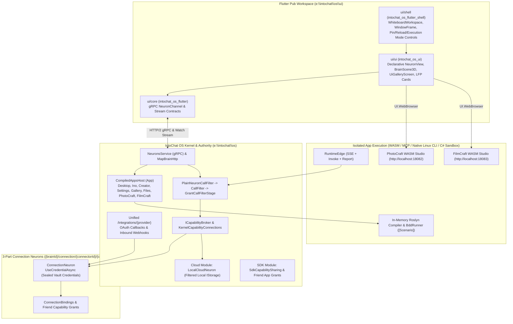
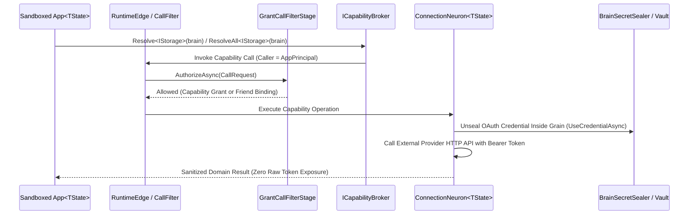

# System Architecture

IntoChat OS is structured across three cleanly decoupled repositories and six architectural pillars so that the core programming model remains lightweight and framework-pure, domain modules stay reusable, and the operating system runtime handles orchestration, sandboxing, zero-token security, and the declarative Flutter desktop.

## End-to-End Topology



## 1. Consolidated Flutter UI Workspace & Single Declarative Toolkit

All Flutter packages reside in a single Dart Pub workspace at `e:\intochat\os\ui\`, completely isolated from MSBuild and `Intochat.OS.slnx` (`Directory.Build.props` excludes `ui\**` from MSBuild globs, and zero `.csproj` files exist under `ui/`):

```text
e:\intochat\os\ui\
├── pubspec.yaml                 # Dart Pub Workspace root (members: core, ui, shell)
├── analysis_options.yaml
├── core\                        # package:intochat_os_flutter (gRPC transport & contracts)
├── ui\                          # package:intochat_os_ui (NeuronView, BrainScene3D, UiGalleryScreen)
└── shell\                       # package:intochat_os_flutter_shell (Whiteboard desktop & WindowFrame)
```

Every built-in app (`DesktopApp`, `WorkspaceApp`, `InoApp`, `CreatorApp`, `SettingsApp`, `GalleryApp`, `PostApp`, `PhotoCraftApp`, `FilmCraftApp`, `Files`, `CalculatorApp`) and every runtime Creator app inherits from `DigitalBrain.App<TState>` and returns declarative `DigitalBrain.UI.View` value trees (`Render()` and `RenderSide()`). Legacy per-widget grain contracts (`ILayout`, `IText`, `IButton`) are eliminated in favor of polymorphic `DigitalBrain.UI` nodes projected through `IView` (`ViewNeuron`).

## 2. Whiteboard Home Desk & Window Top-Bar Controls

- **Whiteboard Home Desk (`WhiteboardWorkspace` & `LiveDesktopShell`)**:
  - Apps on the desktop operate as resizable sticky-note smart cards and floating windows (`DesktopWindowState` + `SmartStickyCardState`) with interactive corner/edge resize handles (`resizeBy`) and drag-to-move (`moveBy`).
  - **Auto-Arrange (`DesktopAutoArrange`)** arranges unpinned apps into a clean, non-overlapping responsive grid while preserving the exact `(x, y, width, height)` of any pinned app.
  - **Always-on-Top Pinning (`LucideIcons.pin`)** locks a window both spatially during auto-arrange and at the top of the z-order stack (`[...unpinnedIds, ...pinnedIds]`).
- **Window Top-Bar Controls (`WindowFrame`)**:
  - **Reload / Hard-Restart Sandbox (`LucideIcons.rotateCw`)**: Short click (`< 500ms`) refreshes the declarative `NeuronView`; long press (`>= 500ms`) or right-click dispatches `sandbox-restart` (`hard-restart`) to tear down and recreate the isolated app sandbox.
  - **Execution Mode & Sandbox Settings Popover (`LucideIcons.slidersHorizontal`)**: Switches per-app execution mode (`WASM Web UI`, `MCP Server`, `Native Linux CLI`), resets sandbox state, or opens `CreatorApp` zoomed into the app's 3D neuron node.
  - **WASM Studios (`UI.WebBrowser`)**: `PhotoCraftApp` (`http://localhost:18082`) and `FilmCraftApp` (`http://localhost:18083`) embed live WASM studios via `UI.WebBrowser` (`WebBrowserNode`).

## 3. Unified `/integrations/{provider}` & Zero-Token Security Model

All external OAuth flows and inbound webhooks route through a single unified HTTP surface (`/integrations/{provider}`) and address multi-account user connections via 3-part `ConnectionKeys` (`{brainId}/connection/{connectorId}/{connectionId}`).



1. **Zero Raw Token Exposure**: `ConnectionNeuron<TState>.UseCredentialAsync` unseals credentials strictly inside the grain activation (`IBrainSecretSealer`), refreshes expired OAuth tokens internally, and **never** returns raw access tokens, refresh tokens, or API keys across grain boundaries.
2. **Call-Filter Enforcement**: `RuntimeEdge`, `PlainNeuronCallFilter`, and `GrantCallFilterStage` reject any attempt by an app principal (`app:*`) to invoke `ISecretValueSource`, `IVault`, or internal credential methods directly.
3. **Core OS Capabilities (`cloud` & `sdk`)**:
   - `LocalCloudNeuron` (`[Neuron("local-cloud")]`) provides path-traversal-safe local `IStorage` (`storage@1`) scoped to the user's local cloud root.
   - `SdkCapabilitySharing` and `ConnectionBindings` enable friend-style capability sharing between trusted apps (`ino` <-> `photocraft`, `ino` <-> `files`, `creator` <-> `bdd`).
