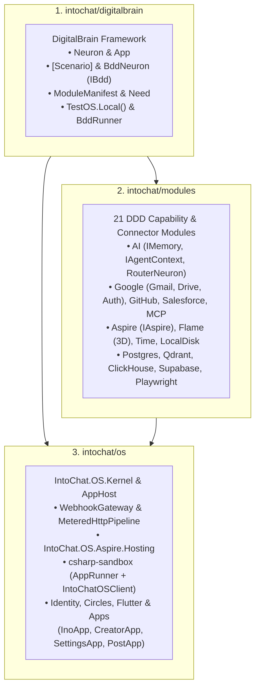

# 3-Repository Architecture

IntoChat is partitioned into three clean layers with strict dependency rules enforced by `IntoChat.OS.Architecture.Tests.Unit`:

## Unified Kernel HTTP & Webhook Gateway

Instead of each connector module re-implementing HTTP retry policies or custom webhook controllers, modules declare `Need.HttpClient` and `Need.Webhook` in their `ModuleManifest`:

- **`MeteredHttpPipeline`**: Provisions named `IHttpClientFactory` pipelines with per-module rate limiting (`RequestsPerMinute`) and automatic OAuth bearer token injection (`ModuleAuth`).
- **`WebhookGateway`**: Exposes `POST /webhooks/{moduleId}`, validates signatures, and dispatches `WebhookPayload` directly to the module's target neuron (`TargetNeuronType`).

## UI Kit, 5 Switchable Identities & 3D Smart Desktop

IntoChat OS ships a WinUI 3-inspired glassmorphic UI Kit (`packages/ui` & `IntoChat.OS.Modules.Flutter`) alongside `[App("gallery")]` (`GalleryApp`) and `[App("desktop")]` (`DesktopApp`):

- **5 Switchable UI Identities (`StylePreset`)**: `fluent-acrylic` (default translucent obsidian glass with 24px backdrop blur and 1px top-lit specular border), `spatial-glass`, `cyber-synaptic`, `warm-paper`, and `linear-carbon`, persisted in `UserSettingsNeuron` (`IUserSettings.SetUiIdentity`).
- **4 Dynamic Bar Layouts (`BarLayout`)**: `floating-glass`, `split-top-dock`, `classic-bottom`, and `compact-pill`.
- **3D DigitalBrain Smart Desktop**: Renders an interactive 3D orbital projection of active neurons, modules, and traveling `[Signal]` photon pulses at 60fps alongside the Ino Smart Brief, Live `[Signal]` Approval queue, and Smart App Launcher.
- **Canonical `neuron://` Distributed Addressing**: Every file, LFP card, and UI surface exposes a canonical `neuron://{brain}/{module}.{neuron}/{key}` URI (for example, `neuron://owner/drive.files/projects/context.md` in `FilesApp` or `neuron://local/apps/ino#card-1` for scoped LFP card sub-streams).
