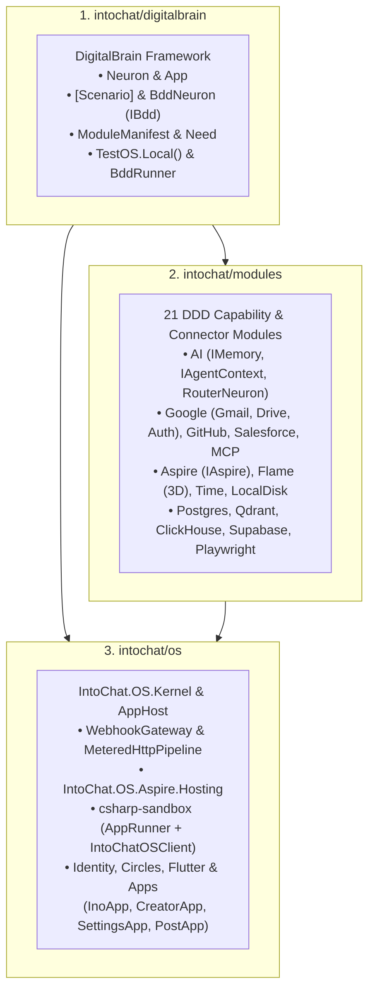

# 3-Repository Architecture

IntoChat is partitioned into three clean layers with strict dependency rules enforced by `IntoChat.OS.Architecture.Tests.Unit`:

## Unified Kernel HTTP & Webhook Gateway

Instead of each connector module re-implementing HTTP retry policies or custom webhook controllers, modules declare `Need.HttpClient` and `Need.Webhook` in their `ModuleManifest`:

- **`MeteredHttpPipeline`**: Provisions named `IHttpClientFactory` pipelines with per-module rate limiting (`RequestsPerMinute`) and automatic OAuth bearer token injection (`ModuleAuth`).
- **`WebhookGateway`**: Exposes `POST /webhooks/{moduleId}`, validates signatures, and dispatches `WebhookPayload` directly to the module's target neuron (`TargetNeuronType`).
