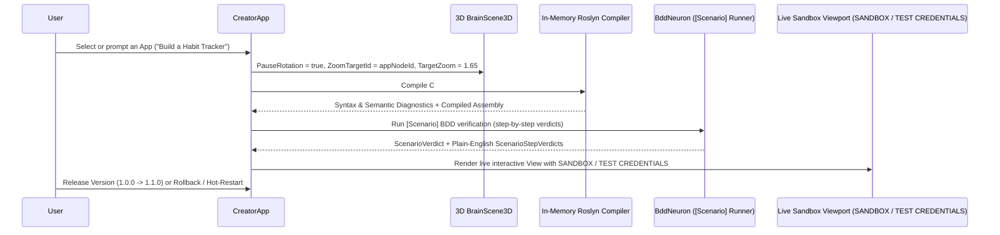

# Creator: 3D Brain Inspector, Plain-English BDD Debugger & Live Sandbox Studio

`CreatorApp` (`creator`) is the self-improving studio inside IntoChat OS where users and AI agents inspect the live 3D brain topology, author or evolve `App<TState>` applications in C#, debug behavior through plain-English (and multi-language) `[Scenario]` BDD specifications, and interact with a live sandboxed viewport before releasing a version.



## 1. 3D Brain Inspector (`BrainScene3D`) with Camera Pause & Smooth Zoom

`CreatorApp` embeds `UI.BrainScene` (`BrainSceneNode`) backed by the interactive Flutter `BrainScene3D` canvas (`e:\intochat\os\ui\ui\lib\src\design\brain_scene_3d.dart`):
- **Idle Orbital Rotation**: When browsing the brain overview, `BrainScene3D` gently rotates the 3D neuron and synapse constellation.
- **Automatic Rotation Halt & Target Zoom**: As soon as a user selects an existing app (`CreatorSelectApp`), inspects a neuron (`CreatorInspect`), or prompts Creator to build/modify an app (`CreatorPrompt`), `CreatorApp` sets:
  - `PauseRotation: true`
  - `ZoomTargetId: selectedNode.Id`
  - `TargetZoom: 1.65`
- `BrainScene3D` immediately halts orbital rotation and smoothly interpolates camera yaw, pitch, and zoom to center on the target app node, displaying live synapse edges and status badges (`healthy`, `failing`, `draft`).

## 2. Plain-English & Multi-Language `[Scenario]` BDD Debugger

Every `App<TState>` embeds `[Scenario]` methods that describe what the app does in plain language (`Given` / `When` / `Then`). `DigitalBrain` captures step-level results in `ScenarioStepVerdict`:

```csharp
public sealed record ScenarioStepVerdict(
    string Step,
    bool Passed,
    string? Error = null,
    TimeSpan Elapsed = default);
```

In `CreatorApp`:
- **Step-by-Step Pass/Fail Indicators**: Non-technical users can read each scenario and step in plain language, seeing green pass indicators (`circle-check`) for verified steps and warning/error indicators (`triangle-alert`) with exact diagnostic messages when a step fails.
- **Multi-Language Support (`CreatorChangeLanguage`)**: Users can switch the BDD specification display language across English (`en`), Ukrainian (`uk`), Spanish (`es`), German (`de`), and French (`fr`).

## 3. Live Sandbox Viewport (`SANDBOX / TEST CREDENTIALS`), Versioning & Hot-Restart

Before any app change reaches the main desktop, `CreatorApp` compiles and runs it inside an isolated studio environment:
1. **In-Memory Roslyn Compilation (`CreatorCompile`)**: Compiles the `App<TState>` C# source in memory via `Microsoft.CodeAnalysis.CSharp`, catching syntax, type, and analyzer diagnostics immediately.
2. **Live Sandbox Viewport Badged `SANDBOX / TEST CREDENTIALS`**: Renders the compiled app's live `DigitalBrain.UI.View` tree inside an interactive sandbox pane prominently badged `SANDBOX / TEST CREDENTIALS`. Capability requests inside the sandbox are routed by `ICapabilityBroker` to isolated test/sandbox credentials so untested code never mutates production accounts.
3. **Semantic Version Releases & One-Click Rollback (`CreatorReleaseVersion`, `CreatorRollbackVersion`)**: Every verified release stores an immutable `CreatorVersionSnapshot(Version, Source, Report, CreatedAt)`, allowing instant rollback to any previous working version.
4. **Hot-Restart (`CreatorHotRestart`)**: Resets the sandbox app state (`new TState()`), re-runs all `[Scenario]` checks, and refreshes the live sandbox viewport in milliseconds without restarting the OS kernel.
