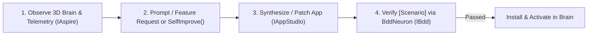

# Creator & Self-Improving Loop

`CreatorApp` (`src/IntoChat.OS.Modules.Apps/Apps/CreatorApp.cs`) is an `App<CreatorAppState>` that enables users and AI assistants to inspect live brain activity in 3D, diagnose runtime failures via `.NET Aspire`, synthesize or patch C# apps, and verify them with `BddNeuron` before installation.

## The 4-Step Self-Improving Loop



### 1. 3D Brain Visualization (`BrainScene`)

When `CreatorApp` opens, its `Render()` method builds a 3D `UiNode.Scene` (`Flare` 3D brain visualization) alongside a code & telemetry inspector:

- Every active neuron in the brain (`ino`, `creator`, `settings`, `memory`, `aspire`, `bdd`, and installed apps) is rendered as a 3D node in orbital space.
- Neurons with recent errors glow red (`#ef4444`); active healthy neurons glow cyan/emerald (`#10b981`).

### 2. Live Telemetry Inspection (`IAspire`)

`CreatorApp` resolves `Get<IAspire>("aspire")` from `IntoChat.OS.Modules.Aspire`:

```csharp
[DefaultNeuronType("aspire")]
public interface IAspire : INeuron
{
    Task<IReadOnlyList<AspireResourceStatus>> GetResources(CancellationToken ct = default);
    Task<IReadOnlyList<AspireLogEntry>> GetConsoleLogs(string resourceName, int limit = 50, CancellationToken ct = default);
    Task<IReadOnlyList<AspireTraceSummary>> GetTraces(string? resourceName = null, int limit = 20, CancellationToken ct = default);
    Task<IReadOnlyList<AspireErrorSummary>> GetRecentErrors(int limit = 20, CancellationToken ct = default);

    [Signal]
    AspireErrorDetected? ErrorDetected { get; }
}
```

Calling `CreatorApp.InspectTelemetry()` fetches all resources and recent structured errors (`GetRecentErrors`) and projects them directly into the 3D scene and error feed.

### 3. AI-Assisted Synthesis (`Prompt` & `SelfImprove`)

- **`Prompt(request)`**: Sends a feature request to `Get<IAppStudio>("main")` (`IAppStudio.Create` or `IAppStudio.Modify`) to synthesize or update a C# `App<TState>` script, or generates a clean `App<TState>` template with embedded `[Scenario]` methods.
- **`SelfImprove()`**: Pulls the latest exception from `IAspire.GetRecentErrors()`, generates a targeted C# patch for the failing neuron/app, and triggers BDD verification.

### 4. Built-in BDD Verification (`BddNeuron`)

Before any synthesized or patched app is marked ready, `CreatorApp.Verify()` runs its `[Scenario]` methods through `Get<IBdd>("bdd")`:

- Every `Given` / `When` / `Then` step is recorded in `BddRunReport`.
- If all scenarios pass (`LastVerificationPassed == true`), the app is installed into the user's Digital Brain.
